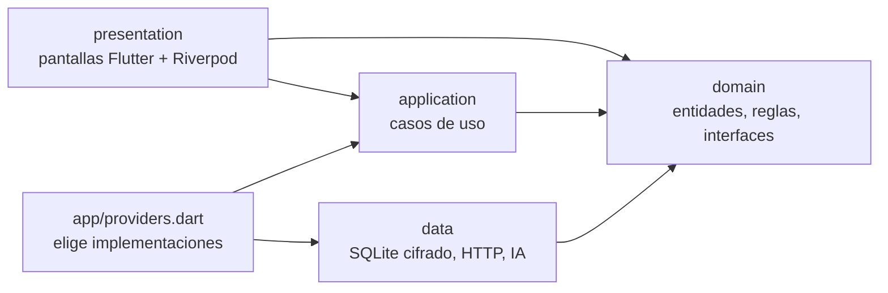
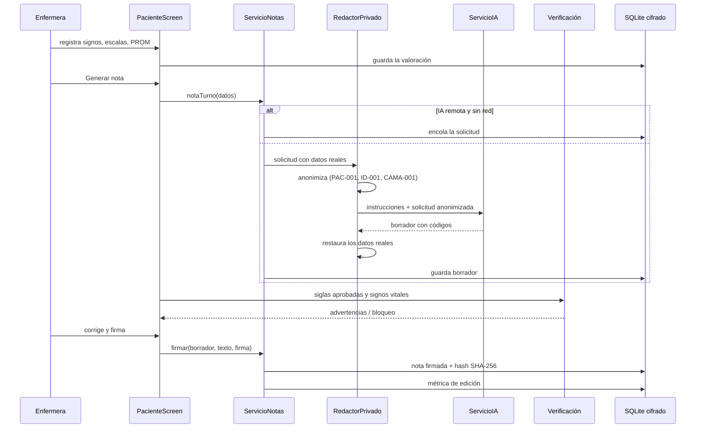

# Arquitectura de la aplicación móvil NoteMed

## Capas (Arquitectura Limpia)

Cada funcionalidad (`lib/features/<nombre>`) se divide en capas. Las
dependencias solo apuntan hacia el dominio (regla de dependencia, Martin
2017). Corresponde a la Tabla 4 del documento del proyecto.

| Capa | Contiene | Ejemplos | No puede importar |
|---|---|---|---|
| domain | Entidades, reglas clínicas, interfaces | `EvaluacionBraden`, `SignosVitales`, `NotaClinica`, `Anonimizador`, `FiltroSiglas`, `ServicioIA`, `RepositorioPacientes`, prompts | Flutter, SQLite, HTTP, otras capas |
| application | Casos de uso que orquestan el dominio | `ServicioNotas` (generar, firmar, aclarar), `GeneradorNotaTurno`, `RedactorPrivado`, `ColaSincronizacion` | Flutter, `data`, `presentation` |
| data | Implementaciones de las interfaces | `RepositorioSqlite`, `RepositorioMetricasSqlite`, `ServicioIASimulado`, `ServicioIARemoto`, `ClaudeServicioIA`, `AutenticacionSimulada` | `presentation` |
| presentation | Pantallas y estado de la interfaz | `PacienteScreen`, `BorradorScreen`, `PromScreen`, `MetricasScreen` | — |

`test/arquitectura_test.dart` revisa estas reglas en cada ejecución de
`flutter test`.

`lib/app/providers.dart` es el único lugar donde se decide qué implementación
concreta se usa. Por ejemplo, cambiar de IA simulada a la IA del servidor es
cambiar `servicioIAProvider`; la lógica clínica no se toca.

## Flujo de una nota

## Decisiones

| Decisión | Motivo |
|---|---|
| IA detrás de la interfaz `ServicioIA` | Cambiar de proveedor sin tocar la lógica clínica. La app trae tres implementaciones. |
| IA simulada por defecto | Permite probar todo el flujo sin backend, sin internet y sin costo. Es determinista y no inventa datos. |
| Anonimización en el celular | Los datos personales nunca salen del dispositivo hacia la IA (Ley 1581 de 2012). Si queda algo sin ocultar, la solicitud no se envía. |
| Verificación determinista después de la IA | Controla alucinaciones: valores de signos distintos o inventados bloquean la firma; siglas no aprobadas generan advertencia. |
| Nota firmada inmutable | Ley 911 de 2004 art. 38 y Resolución 1995 de 1999. Se valida en el dominio, en el repositorio y con un trigger de SQLite. Hash SHA-256 para detectar alteraciones. |
| SQLCipher + almacenamiento seguro | Base local cifrada; la clave de 256 bits vive en Keystore/Keychain. |
| Cola de solicitudes | Offline-first: si la IA remota no responde, nada se pierde; se reintenta al volver la red. |
| Prompts versionados como código | `versionPrompts` se guarda en cada nota y métrica (MLOps). |
| Riverpod | Inyección de dependencias y estado probables con `overrideWithValue` en las pruebas. |

## Base de datos local

Archivo `notemed_cifrada.db` (SQLCipher). Versión 2.

| Tabla | Contenido |
|---|---|
| `pacientes` | Datos básicos (sintéticos en desarrollo). |
| `signos_vitales`, `infusiones`, `procedimientos` | Registro del turno. |
| `evaluaciones` | Braden, Downton y PROM en JSON (una fila por escala). |
| `notas` | Borradores y notas firmadas, versión de prompts, nota aclarada, hash. Trigger `notas_firmadas_inmutables`. |
| `cola_pendientes` | Solicitudes a la IA hechas sin red. |
| `metricas` | Aceptación y edición por nota. Sin datos del paciente. |

## Pruebas

| Tipo | Dónde |
|---|---|
| Reglas clínicas (escalas, signos, siglas, anonimización) | `test/features/*/` |
| Casos de uso (generar, firmar, aclarar, cola) | `test/features/notas`, `test/features/sincronizacion` |
| Pantallas | pruebas de widgets en las mismas carpetas |
| Arquitectura | `test/arquitectura_test.dart` |
| Dispositivo real (SQLCipher, flujo completo) | `integration_test/` |
